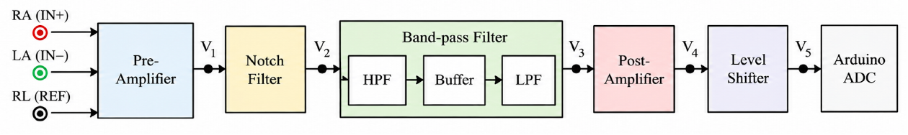
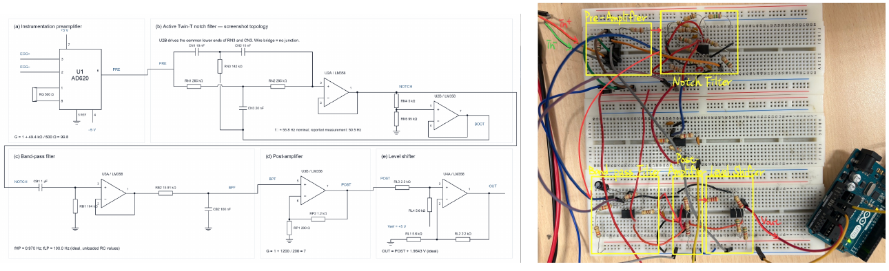
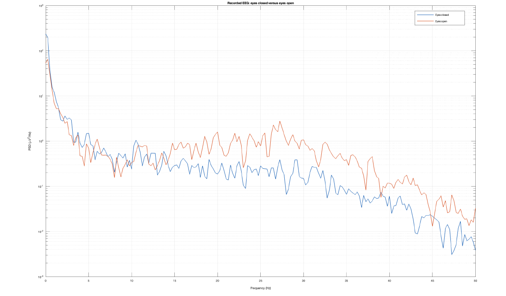
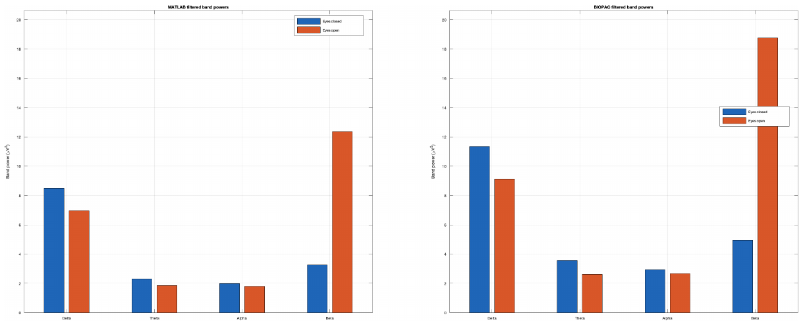

# Biomedical Signal Acquisition and EEG Analysis

Course laboratory portfolio covering ECG/EMG acquisition circuits, EEG spectral analysis, and offline EEG task classification. This repository documents completed laboratory work.

## My contributions

My work focused on:

- EEG digital filtering, Welch PSD analysis, and MATLAB/BIOPAC comparison in Experiment 2.
- Investigation of a low-performing participant and verification testing in Experiment 3.
- Technical documentation and shared ECG/EMG circuit design, assembly, debugging, and measurements.

The classification pipeline is a team result. Another team member led implementation and result analysis; another led the classification report and parameter tuning. Flutter development and Arduino/Bluetooth implementation were handled by teammates. See [team contributions](docs/contributions.md).

## ECG/EMG acquisition

The team built an analog front end with an AD620 preamplifier, a mains notch filter, signal-specific band-pass filtering, post-amplification, and level shifting. Arduino sampling and HM-10 BLE transmission supported smartphone waveform visualization.

| Measurement | Reported result |
| --- | --- |
| Notch center | 59.5 Hz |
| Attenuation at notch center | Approximately 38 dB |
| ECG band-pass range | Approximately 0.9–98.6 Hz |
| EMG band-pass range | Approximately 8.5–420 Hz |

The 500 Hz sampling rate does not preserve the full EMG bandwidth: signal components above 250 Hz can alias. Eight-bit transmission also limits amplitude resolution. These are educational measurements, without clinical validation.

### Circuit architecture and stage measurements

The analog front end was designed, assembled, and measured jointly by the team. Circuit excerpts and measurements are from Experiment 2; full-size stage figures are linked below.

| Stage | Documented design and measured result | Figures |
| --- | --- | --- |
| Preamplifier | AD620, Rg = 500 Ω; ideal gain 99.8, measured gain 96.69 | [Circuit and test waveform](assets/pre-amplifier.png) |
| Notch filter | Measured center 59.5 Hz; approximately 38 dB attenuation at the center | [Circuit and Bode plot](assets/notch-filter.png) |
| Band-pass filter | ECG: approximately 0.9–98.6 Hz; EMG: approximately 8.5–420 Hz | [ECG](assets/ecg-band-pass-filter.png) · [EMG](assets/emg-band-pass-filter.png) |
| Post-amplifier | ECG: measured gain 7; EMG: measured gain 9.9 | [ECG](assets/ecg-post-amplifier.png) · [EMG](assets/emg-post-amplifier.png) |
| Level shifter | Calculated offset 1.96 V; measured DC output 1.97 V | [Circuit and test waveform](assets/level-shifter.png) |

[Hardware design details and full figure gallery](docs/hardware-design.md)

The report’s complete-circuit drawings contain component-label inconsistencies; see the hardware notes. Stage-specific EMG figures are provided instead of the inconsistent complete EMG drawing.

These stage measurements use the test signals specified in the figures. They do not establish clinical measurement accuracy.

## EEG spectral analysis

Experiment 2 analyzed BIOPAC EEG sampled at 200 Hz, comparing eyes-closed and eyes-open intervals using Butterworth band-pass filtering and Welch PSD estimation. MATLAB and BIOPAC filtering showed similar directions of band-power change, with different absolute values.

In the selected MATLAB analysis intervals, alpha power was 1.979 µV² with eyes closed and 1.788 µV² with eyes open. Beta power was 3.262 µV² and 12.348 µV², respectively. Eye and muscle artifacts were not explicitly removed, so these observations cannot be attributed solely to neural activity.

[Additional filter comparison](assets/eeg-filter-comparison.png)

## Offline EEG classification

Experiment 3 used single-channel BrainLink Fp1 recordings at 512 Hz from three participants, with 90 recordings across Relax, Focus, and Stroop tasks. Twelve-second windows with a two-second step produced 449 evaluated segments. Segments overlap and are not independent observations.

The pipeline uses linear detrending, a 60 Hz notch filter, and 13 log spectral-band features estimated with Welch PSD. Standardization is fitted on the training participants in each leave-one-subject-out fold.

| Pipeline | Mean LOSO accuracy | SD across 3 folds |
| --- | --- | --- |
| MLP + shared post-processing | 67.5% | 22.0 percentage points |
| SVM + shared post-processing | 65.5% | 28.1 percentage points |
| Random Forest + shared post-processing | 70.4% | 26.8 percentage points |
| ExtraTrees + shared post-processing | 79.3% | 15.4 percentage points |

All four results include batch class-probability balancing and pseudo-label self-training with shrinkage LDA on the unlabeled held-out participant. This is an offline, transductive evaluation. The procedure assumes approximately equal class proportions and requires a batch of test features; it has not demonstrated real-time single-window prediction.

The report gives ExtraTrees accuracy of 60.6% without post-processing, 73.7% with balancing, and 79.3% with balancing and self-training. These ablations are reported results; separate ablation scripts and complete outputs are not distributed here.

## Verification and limitations

My investigation examined substantial participant variability through additional recordings and session-based verification. The report found higher within-participant, cross-session performance than cross-participant performance for the investigated case. This suggests participant-specific differences without establishing a physiological cause. The additional recordings and session-validation script are not distributed here.

Only three participants were evaluated. Feature and parameter choices were compared on the same LOSO dataset, so the reported scores are development results rather than an untouched external benchmark. Fp1 features also retain eye and muscle activity that may encode task behavior. More participants, independent sessions, and prospective testing are needed.

## Materials and reproducibility

This is a results portfolio. Raw participant recordings, identifying information, full course reports, and source code are not distributed here. The reported experiments have not been independently rerun for this portfolio. Reproducing the original scores requires the private recordings and original implementation.

- [Hardware design and measurements](docs/hardware-design.md)
- [Technical notes and limitations](docs/technical-notes.md)
- [Team contributions](docs/contributions.md)
- [Aggregate classification results](results/classification-summary.csv)

## Credits

Completed by a three-person team in Biomedical Engineering Lab, Fall 2026, using course-provided scaffolding. Figures are selected excerpts from the team’s Experiment 2 report. Classification metrics are from the team’s Experiment 3 report and saved result summary. The original implementation is not represented as independently authored work.

No blanket open-source license is assigned to team or course materials in this portfolio.
