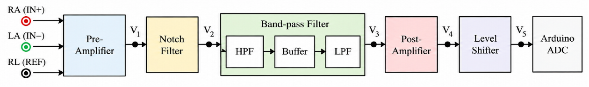
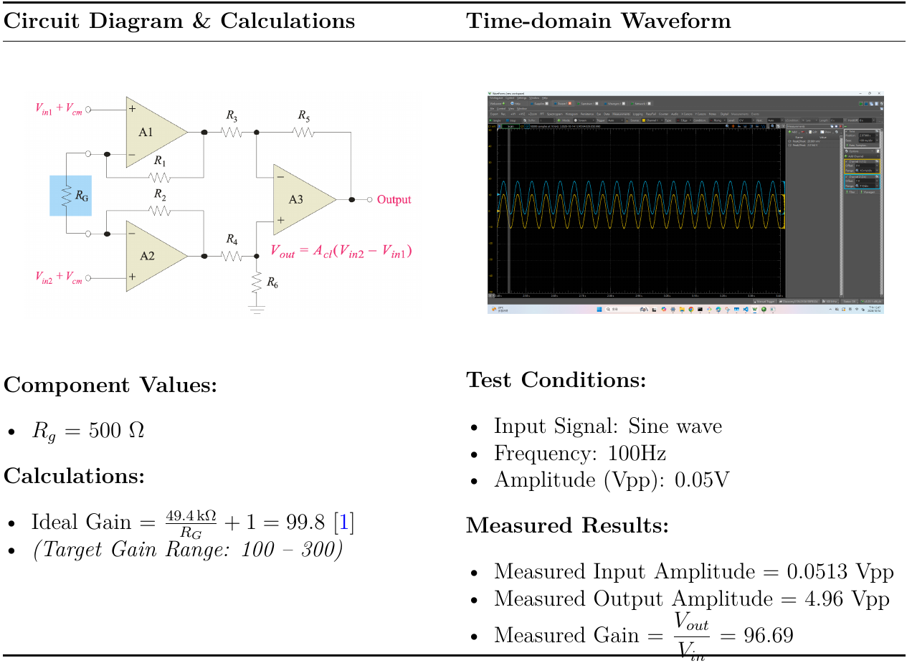
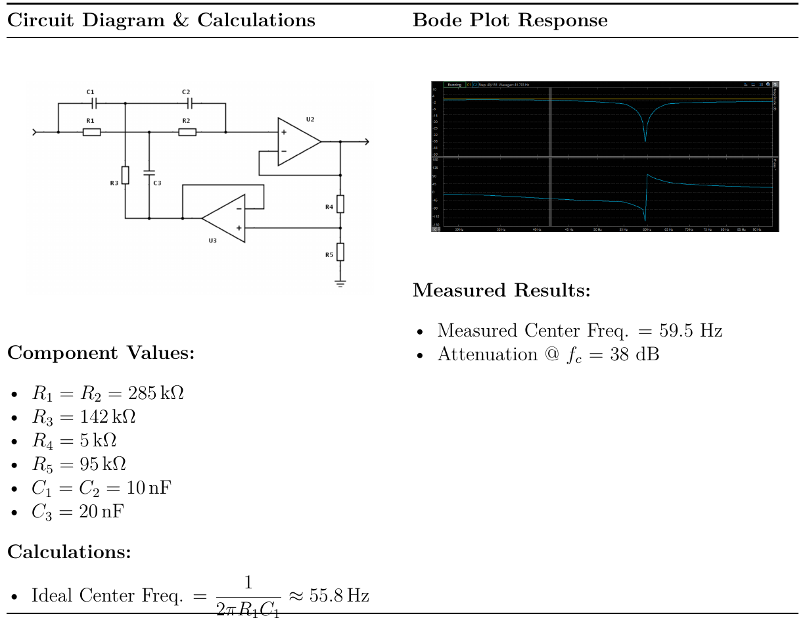
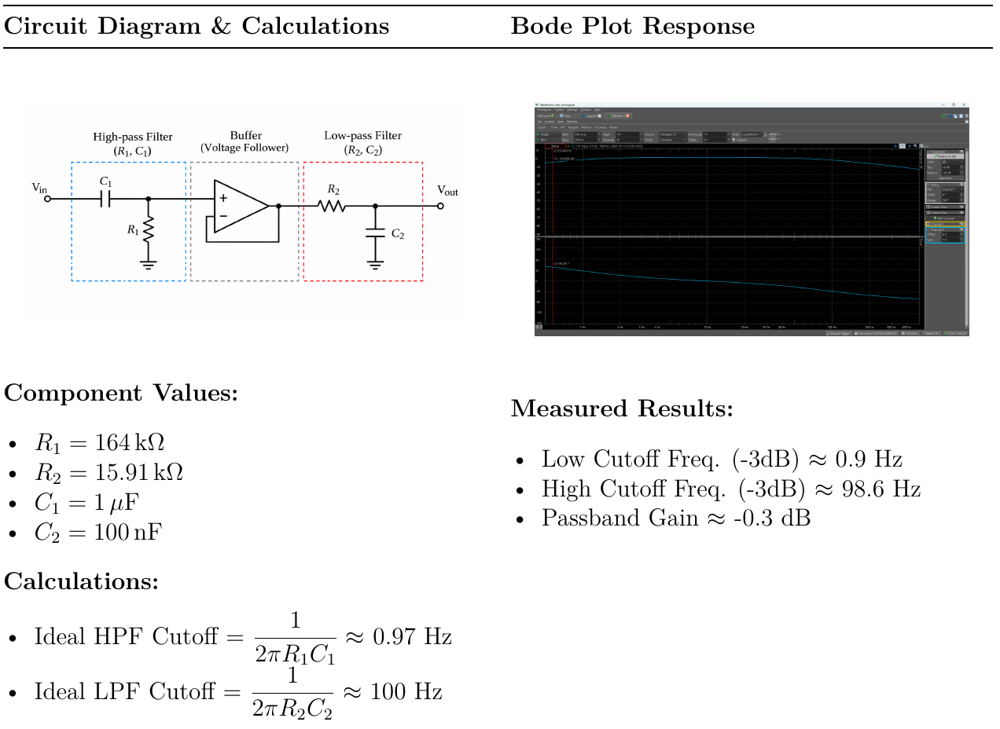
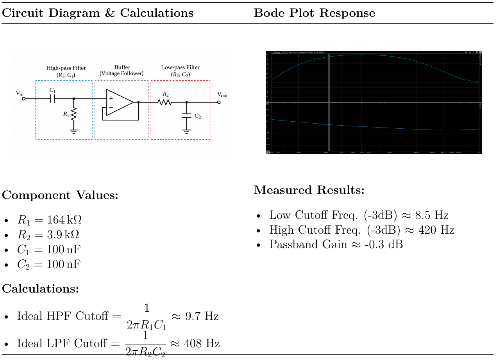
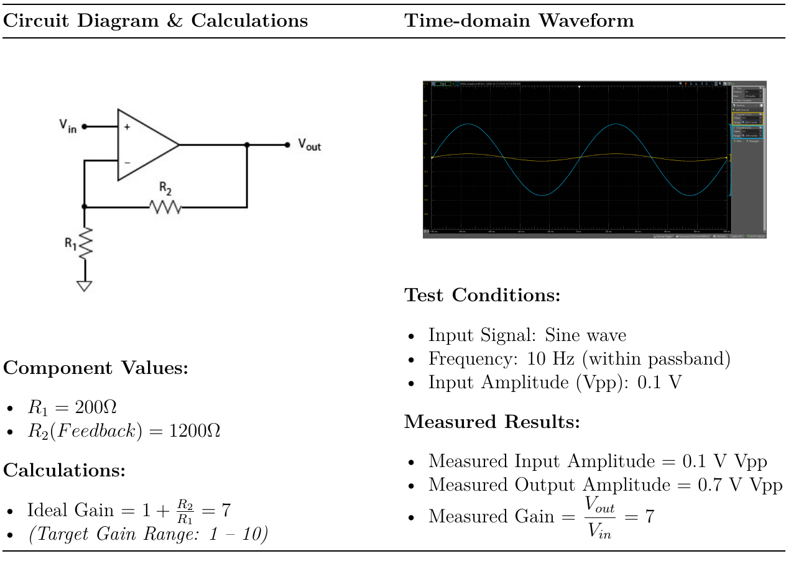
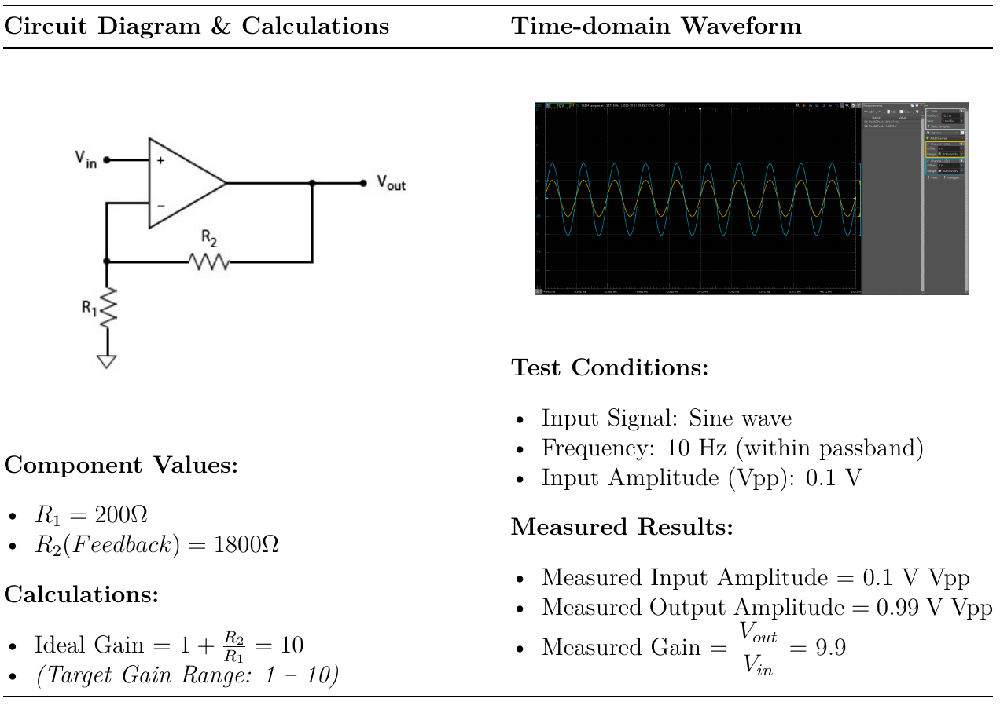
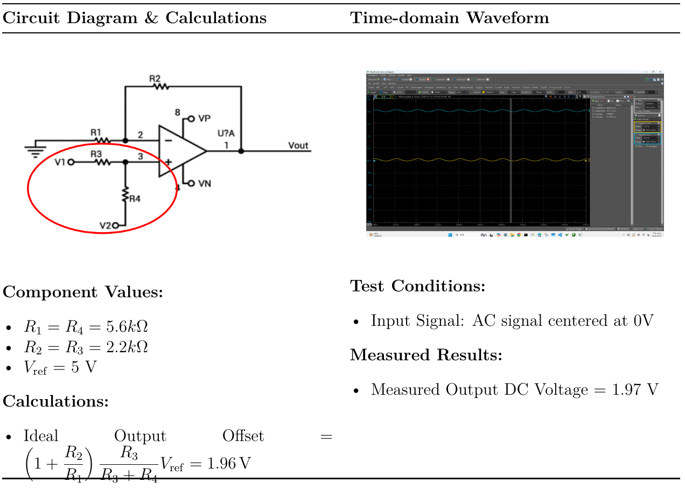
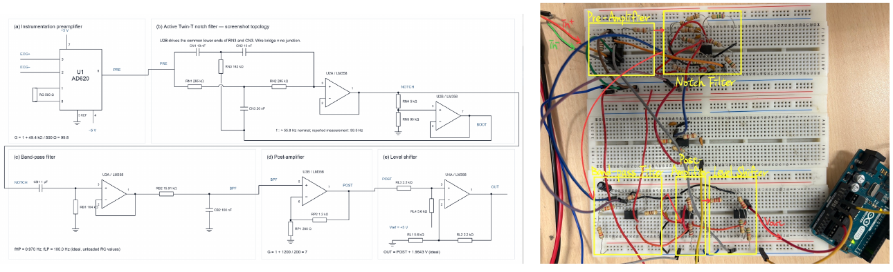

# ECG/EMG analog front-end design and measurements

The circuit design, assembly, debugging, and measurements were shared responsibilities of the three-person laboratory team. These figures are excerpts from the original Experiment 2 report, with report headers, page footers, and unrelated text excluded. They are not newly measured results.

## System architecture

The analog chain consists of a preamplifier, notch filter, HPF/buffer/LPF band-pass stage, post-amplifier, and level shifter feeding an Arduino ADC. The ECG and EMG paths use the same overall architecture with different component values.

## 1. Preamplifier

The report uses an AD620 instrumentation amplifier with Rg = 500 Ω. The ideal gain is 49.4 kΩ / Rg + 1 = 99.8. For a 100 Hz sine-wave test, measured input and output were 0.0513 Vpp and 4.96 Vpp, giving a gain of 96.69. The same preamplifier is used for ECG and EMG.

The left panel is the instrumentation-amplifier principle diagram used in the report; it is not an independently designed internal AD620 schematic. The original report cites the Analog Devices AD620 datasheet for the gain relationship; the principle diagram is reproduced from the report.

## 2. Notch filter

The component-based calculation in the report gives an ideal center of approximately 55.8 Hz. The measured center is 59.5 Hz, with approximately 38 dB attenuation at that center. This is not a separate measurement of attenuation at exactly 60 Hz.

## 3. Band-pass filters

Each band-pass stage combines a first-order HPF, a voltage-follower buffer, and a first-order LPF. ECG measured cutoffs are approximately 0.9 and 98.6 Hz; EMG measured cutoffs are approximately 8.5 and 420 Hz. Both have a reported passband gain of approximately -0.3 dB.

### ECG

### EMG

## 4. Post-amplifiers

Both are non-inverting stages, with R1 = 200 Ω. ECG uses feedback resistance 1200 Ω, giving ideal and measured gain 7. EMG uses 1800 Ω, giving ideal gain 10 and measured gain 9.9. The documented tests use 10 Hz sine waves with 0.1 Vpp input.

### ECG

### EMG

## 5. Level shifter

The report lists R1 = R4 = 5.6 kΩ, R2 = R3 = 2.2 kΩ, and a 5 V reference. The calculated output offset is 1.96 V and the measured DC output is 1.97 V. ECG and EMG share this stage. Component labels below reproduce the report and should be checked against the original wiring before reuse.

## Complete implementations

### ECG

### Source-drawing inconsistencies

The report’s complete EMG drawing (p. 10) repeats ECG values (1 µF / 15.91 kΩ in the band-pass stage and 1.2 kΩ feedback in the post-amplifier), whereas the EMG stage sections specify 100 nF / 3.9 kΩ and 1.8 kΩ. It is therefore omitted from this gallery. The EMG stage figures above reflect the values documented in the EMG sections.

The level-shifter component labels also differ between the individual stage and complete ECG drawing. Both excerpts are preserved as source documentation; they should not be treated as a verified, mutually consistent as-built netlist. The measured 1.97 V DC output is reported separately from the drawing labels. Resolving these differences requires the original wiring or design files; no corrected schematic is invented here.

## Scope and limitations

These excerpts document an educational prototype, without clinical accuracy or electrical-safety validation. Stage gains were measured separately under their listed test conditions and should not be interpreted as measured full-chain gain. The 500 Hz acquisition rate has a 250 Hz Nyquist limit, below the measured EMG upper cutoff; aliasing and eight-bit transmission limit fidelity.

The report discusses amplifier saturation and notch-frequency deviation during debugging. Full circuit diagrams reproduce the report’s recorded design and are not a substitute for verifying an as-built netlist or testing a new build.

## Figure sources

All page references are to the original team Experiment 2 report:

| Figure asset | Report page |
| --- | --- |
| Acquisition block diagram; preamplifier | 2 |
| Notch filter (existing asset) | 3 |
| ECG band-pass filter | 4 |
| ECG post-amplifier | 5 |
| Level shifter; complete ECG circuit | 6 |
| EMG band-pass filter | 8 |
| EMG post-amplifier | 9 |
| Complete EMG circuit (reviewed but omitted due to inconsistent values) | 10 |
